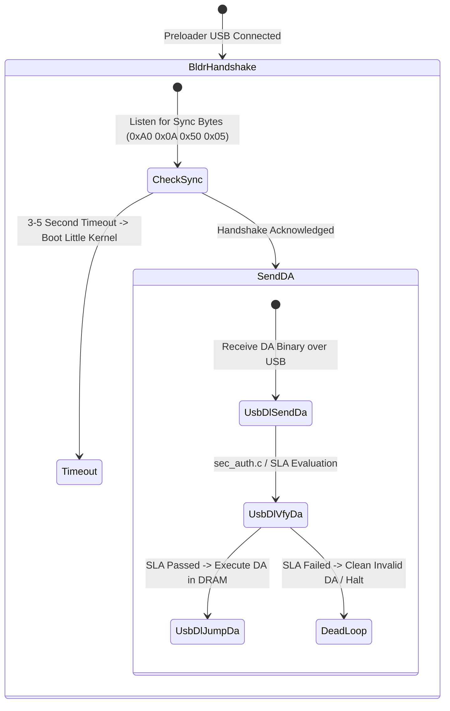

# Realme 1 (CPH1859): Static Inventory of Alternative Unlock Paths

**Document ID:** `ART-013`  
**Classification:** Static Reverse Engineering & Attack Surface Inventory  
**Analyzed Subsystems:**
- Little Kernel (`lk.img`, C.49 & C.50)
- Stock Recovery (`recovery.img`, C.49 baseline)
- Preloader (`preloader_oppo6771_17065.bin` & `preloader_emmc.img`)

---

## Executive Summary

To determine whether an alternative, non-destructive, software-only route to bootloader unlocking exists, this report statically inventories every identifiable command handler, service routine, and dispatch interface across Little Kernel, stock Recovery, and the Preloader.

**Key Findings:**
1. **Fastboot Command Dispatch:** Fastboot implements 21 command handlers. All 21 handlers are registered strictly *after* `verify_unlock_token()` returns 0. The legacy command `fastboot oem unlock` is completely absent from the binary.
2. **Unlock Execution Handler (`cmd_flashing_unlock`):** Even if Fastboot execution were reached, `flashing unlock` enforces a strict secondary check on the `frp` partition flag (`unlock_allowed_flag`) and requires physical Volume Up confirmation before modifying `seccfg` and wiping `userdata`/`keystore`.
3. **Stock Recovery Isolation:** Disassembly and string searching of `sbin/recovery` extracted from the accessible `recovery.img` show no direct references to `reserve4`, `seccfg`, or `fastboot`. This is evidence against those direct paths, not proof that every indirect helper or external recovery script lacks such behavior.
4. **Preloader USB Protocol Boundaries:** The reference preloader contains a CDC ACM/Download-Agent state machine and secure-chip/certificate-policy paths. The string `usbdl_vfy_da:disabled` means one software verification stage is disabled or configured out; it does not by itself prove that the complete runtime path is unauthenticated or authenticated. The full indirect call graph remains a bounded uncertainty.
5. **Alternative Debug / Engineering Commands:** Engineering commands present in Little Kernel (`oem usb2jtag`, `oem scp_*`, `oem ultraflash:`) provide peripheral diagnostic telemetry but contain no memory write or partition flashing bypasses.

---

## 1. Little Kernel Fastboot Command Architecture

### 1.1 Command Registration Table
In Little Kernel, `fastboot_init()` registers command handlers via `fastboot_register(prefix, handler, flags, ...)` (function `0x6002F928`). The complete, exhaustive table of registered commands extracted from disassembly is:

| Command String | Registration Call | Handler Address | Role & Operational Scope | Reachable Pre-Unlock Token? |
|---|---|---|---|---|
| `getvar:` | `0x600300BA` | `0x60035070` | Queries bootloader variables (`version`, `unlocked`, `secure`, etc.) | **NO** (Gated by token) |
| `signature` | `0x60030110` | `0x60035118` | Uploads raw signature block for secure flashing | **NO** (Gated by token) |
| `flash:` | `0x60030120` | `0x600352A8` | Flashes partition image payload from download buffer | **NO** (Gated by token) |
| `erase:` | `0x60030130` | `0x60035548` | Erases specified eMMC partition | **NO** (Gated by token) |
| `continue` | `0x60030140` | `0x600356C0` | Continues normal boot sequence into Linux kernel | **NO** (Gated by token) |
| `reboot` | `0x60030150` | `0x60035728` | Reboots device via Watchdog Timer reset | **NO** (Gated by token) |
| `reboot-bootloader` | `0x60030160` | `0x60035750` | Sets BCB reboot reason and resets to fastboot | **NO** (Gated by token) |
| `download:` | `0x6003024C` | `0x60035788` | Receives binary payload into DRAM download buffer | **NO** (Gated by token) |
| `oem p2u` | `0x6003026C` | `0x60035B98` | Switches USB mode (power-to-UART / diagnostic) | **NO** (Gated by token) |
| `oem reboot-recovery` | `0x6003027C` | `0x60035BC0` | Writes `boot-recovery` to `misc` partition and reboots | **NO** (Gated by token) |
| `boot` | `0x600302BC` | `0x60035BF8` | Boots kernel directly from download buffer | **NO** (Gated by token) |
| `flashing unlock` | `0x600302CC` | `0x60036648` | Initiates interactive bootloader unlock flow | **NO** (Gated by token) |
| `flashing lock` | `0x600302DC` | `0x60036920` | Relocks bootloader and zeroes token slot | **NO** (Gated by token) |
| `flashing get_unlock_ability`| `0x600302EC` | `0x60036518` | Queries a persistent FRP flag used by unlock flow | **NO** (Gated by token) |
| `oem scp_status` | `0x600302FC` | `0x60035CB0` | Queries System Co-Processor (SCP) status | **NO** (Gated by token) |
| `oem scp_log_thru_ap_uart` | `0x6003030C` | `0x60035CD8` | Reroutes SCP debugging logs to AP UART TX | **NO** (Gated by token) |
| `oem scp_scpctl` | `0x6003031C` | `0x60035D08` | Issues hardware control command to SCP core | **NO** (Gated by token) |
| `oem usb2jtag` | `0x6003032C` | `0x60035D38` | Toggles USB D+/D- pins into JTAG interface mode | **NO** (Gated by token) |
| `oem ultraflash:` | `0x6003033E` | `0x60035D70` | Factory high-speed raw block streaming protocol | **NO** (Gated by token) |
| `oem ultraflash_en` | `0x6003034E` | `0x60035DA8` | Enables Ultraflash mode flag | **NO** (Gated by token) |
| `ultraflash:` | `0x6003035C` | `0x60035D70` | Alias for `oem ultraflash:` | **NO** (Gated by token) |

### 1.2 Handlers Analysis: `flashing unlock` & `flashing lock`

#### `cmd_flashing_unlock` (`0x60036648`):
1. **Entry Check:** Calls `0x60036390` (`get_unlock_ability`).
   - Reads 4 bytes from offset `partition_size - 4` of partition `"frp"`; LK evidence does not prove that this is identical to Android's `sys.oem_unlock_allowed` property.
   - If flag `unlock_allowed == 0`: immediately aborts, logging:
     `"\nUnlock operation is not allowed\n"` (`0x60083982`) and sending Fastboot `FAIL`.
2. **User Confirmation Prompt:**
   - Prints multi-line warning on LCD console via `0x60036408`:
     `"Unlock bootloader?\nIf you unlock the bootloader, you will be able to install custom operating system software on this phone..."`
   - Loops polling hardware keys via `0x600519D4`:
     - Volume Up: Confirm unlock.
     - Volume Down: Cancel unlock (`"Unlock failed...return to fastboot in 3s\n"`).
3. **Execution (`unlock_erase` at `0x600366F0`):**
   - Erases `userdata` and `keystore` (`oemkeystore`) partitions via `0x6004DB18` / `0x6004E974`.
   - Calls `0x6005576C` to update `seccfg` partition: clears device lock bit (`lock_state = 0` / Orange state).
   - Prints `"Unlock Pass...return to fastboot in 3s\n"` (`0x600839F8`).

#### `cmd_flashing_lock` (`0x60036920`):
1. Enforces identical interactive prompt (Volume Up to lock, Volume Down to cancel).
2. Calls `clean_flash_unlock_data()` at `0x6002EACC`.
   - `clean_flash_unlock_data` allocates a zeroed 4 KB buffer on the stack.
   - Calls `write_reserve4(buf, sector=0x16, count=8)` (`0x6002C794`), overwriting sector `0x7816` of `reserve4` with zeros.
3. Updates `seccfg` partition: sets `lock_state = 1` (Green state).
4. Erases `userdata` and `keystore`.

---

## 2. Stock Recovery Subsystem Analysis (`recovery.img`)

The recovery ramdisk was decompressed from `~/Realme1/C49_extracted/recovery.img` (gzip CPIO, 61,841,152 bytes uncompressed). Static inspection of `sbin/recovery` (1,266,160 bytes, SHA-256: `05cfcf8ffbb59abcbd642a950989cc4d112d1985ad1a4c9eab642ce4e67bdb34`) and helper scripts establishes:

### 2.1 Supported Recovery Operations
Stock recovery implements standard Android Recovery commands supplied via the `misc` partition BCB (`/cache/recovery/command`):
- `--update_package=<path>`: Applies signed OTA update package.
- `--wipe_data`: Formats `/data` and `/cache`.
- `--wipe_cache`: Formats `/cache`.
- `--sideload`: Receives OTA package over ADB sideload interface.

### 2.2 Security & Partition Boundaries
- **No Fastboot Daemon:** `sbin/recovery` contains no Fastboot server or USB communication endpoints for flashing arbitrary partitions.
- **OTA Verification:** Sideloaded or local update packages (`.ozip` / `.zip`) are strictly verified against compiled-in OEM X.509 certificates (`res/keys`). Unsigned, modified, or cross-model packages are rejected prior to execution.
- **Partition Isolation:** The accessible `sbin/recovery` has no direct references to `reserve4`, `seccfg`, or `frp`. That negative string result does not prove the absence of indirect behavior in helpers or scripts not included in this narrow extraction.

---

## 3. Preloader USB Protocol Boundaries (`0e8d:2000`)

Preloader exposes a USB CDC ACM interface (`0e8d:2000`) before Little Kernel initializes.

### 3.1 State Transitions & Command Dispatch
From disassembly of `main.c`, `download.c`, and `sec_auth.c`:

### 3.2 Gating Logic & Authentication Boundaries
1. **Security-policy evidence (not a complete proof of every runtime branch):**
   - String `usbdl_vfy_da:disabled` is present, indicating that one DA-container verification stage is disabled or configured out. Other secure-chip and authentication-policy code is also present, but the complete indirect runtime path is not reconstructed here.
   - If the physical device is in the `S-CHIP` state and the relevant policy branch is reached, authenticated DA execution is strongly supported; the physical fuse state and exact host-reachable path remain unknown.
2. **Kamakiri / USB Crash Payload Resistance:**
   - Software-based Preloader crashing payloads (`kamakiri` / `crash da`) rely on integer overflows in earlier MediaTek USB control packet parsers.
   - Community reports associate 2020 MT6771 builds with rejected crash payloads and timeout codes (`0x1d18`/`0x1d1a`), but this was not live-tested on the exact CPH1859 and is not proven solely by the presence of the reference strings.

---

## 4. Debug, Engineering & Service Interfaces

Static scanning for engineering strings and command handlers in `lk.img` revealed the following specialized interfaces:

### 4.1 `oem usb2jtag` (`0x60035D38`)
- **Observed Behavior:** Reconfigures GPIO pins on the MT6771 SoC to multiplex JTAG debug signals onto the USB D+ and D- pins.
- **Security Scope:** If JTAG is permanently disabled in SoC eFUSE (`Disable_JTAG = true` in `17065-efuse_oppo6771.xml`), hardware registers ignore pin multiplexing. It provides no read/write access to flash storage.

### 4.2 `oem scp_*` Commands (`0x60035CB0`–`0x60035D08`)
- **Observed Behavior:** Communicates with the low-power System Co-Processor (SCP) core for sensor and power management debugging.
- **Security Scope:** Restrained to SCP mailbox registers; cannot modify AP bootloader control flow or partition data.

### 4.3 `oem ultraflash:` (`0x60035D70`)
- **Observed Behavior:** Proprietary Oppo high-speed factory flashing protocol.
- **Security Scope:** Requires `oem ultraflash_en` flag and validates signed partition metadata. It is subject to the identical `fastboot_init()` gating requirement as standard Fastboot.

---

## 5. Alternative Path Feasibility Summary

| Candidate Entry Path | Required Preconditions | Gating Mechanism | Status on Retail C.50 Device |
|---|---|---|---|
| **Direct Fastboot Commands** | Phone booted to fastboot mode | `verify_unlock_token()` eFUSE serial + RSA check | **BLOCKED:** Watchdog hard reboot on invalid token |
| **`fastboot oem unlock`** | Fastboot execution | Command existence | **ABSENT:** Command not registered in binary |
| **Stock Recovery Sideload** | Boot into Recovery mode | X.509 signature verification against OEM keys | **BLOCKED:** Rejects modified/custom update packages |
| **Recovery Partition Edit** | Recovery mode execution | Tooling & partition access | **BLOCKED:** Recovery binary contains no partition edit logic |
| **Preloader USB Download** | USB connection during power-on | DA/security policy and indirect authentication paths | **UNKNOWN/NOT DEMONSTRATED:** reference contains security-policy paths, but `usbdl_vfy_da:disabled` prevents a categorical claim from strings alone |
| **Preloader Crash to BROM** | USB handshake packet injection | USB parser behavior and internal reset preconditions | **UNKNOWN ON THE EXACT DEVICE:** reference contains emergency BROM-reset paths; no live test was performed |
| **Developer Options FRP Flag** | Booted Android OS | `frp` partition flag | **INSUFFICIENT:** Evaluated post-fastboot; does not bypass LK token gate |

