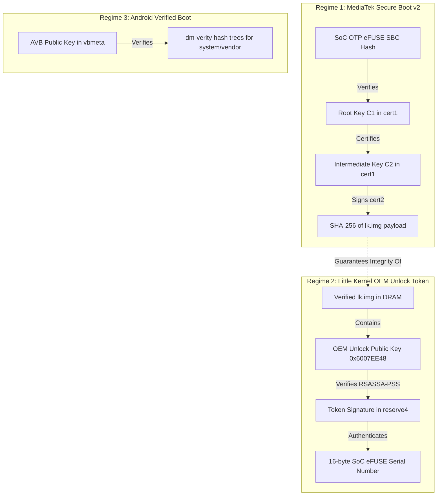

# Realme 1 (CPH1859): Bootloader Authorization Protocol Analysis

**Document ID:** `ART-012`  
**Classification:** Static Reverse Engineering & Cryptographic Protocol Analysis  
**Analyzed Images:**
- Little Kernel C.49: `lk.img` (753,984 bytes, SHA-256: `30b48cd52b5d6035819c5580eb4a7f745010042318d1358b46a4f9fd5a37baaa`)
- Little Kernel C.50: `lk.img` (753,984 bytes, SHA-256: `58cd19a9647610146f07bcf2ad5a1b0cd3056ce967c784bb37ea347669f5e563`)
- eFUSE Configuration: `17065-efuse_oppo6771.xml` (SHA-256: `cfbb9b87df1c0a0c64c12513f4c6e6b54a8ea6c750ba41ef03714b16016e78cf`)

---

## Executive Summary

Static disassembly and cryptographic tracing of `lk.img` across C.49 and C.50 establish the complete, deterministic control flow of the Realme 1 bootloader authorization mechanism:
1. **Gating Function:** `fastboot_init()` (RAM `0x60030018`–`0x60030628`) unconditionally calls `verify_unlock_token()` (RAM `0x6002EB00`–`0x6002EDCC`) before initializing the USB fastboot interface or registering any fastboot commands.
2. **Token Storage & Layout:** 4,096 bytes are read from partition `reserve4` at **sector `0x7816`** (`read_reserve4` adds base `0x7800` to argument `0x16`). The layout contains a 256-byte signature at offset `+0x000` and a 16-byte ASCII device serial number at offset `+0x100`.
3. **Cryptographic Algorithm:** The verifier does NOT use PKCS#1 v1.5. Disassembly of `0x600567C0` proves mathematically that it enforces **RSASSA-PSS SHA-256** with MGF1(SHA-256), salt length 32 (`0x20`), and trailer field byte `0xBC`.
4. **Digest Calculation:** The signature is verified against the 32-byte SHA-256 digest calculated strictly over the 16 bytes of the SoC serial number. No timestamp, nonce, or model string is included in the hash.
5. **Public Key Material:** Verified using a hardcoded OEM 2048-bit RSA public key modulus at RAM `0x6007EE48` (file `0x7F048`), distinct from the MediaTek Secure Boot v2 eFUSE root key (`Key C1`).
6. **Failure Action:** Any failure in serial matching or signature verification logs `fastboot_unlock_verify fail\n\n` and immediately invokes `[WDT] mtk_arch_reset(1)`, writing `0x1971` to register `0x10007000` to force an immediate hardware reboot.

---

## 1. Fastboot Initialization Gate (`fastboot_init`)

The Little Kernel application `fastboot` begins execution at `0x60030018`. Disassembly reveals the exact authorization gate:

```arm
0x60030018:  push.w     {r4, r5, r6, r7, r8, sb, sl, lr}
...
0x60030046:  bl         #0x6002eb00       ; call verify_unlock_token()
0x6003004A:  cmp        r0, #0
0x6003004C:  beq.w      #0x600303e6       ; branch if token verified (r0 == 0)
0x60030050:  ldr.w      r0, [pc, #0x424]  ; lit@0x60030478 -> "fastboot_unlock_verify fail\n\n"
0x60030054:  add        r0, pc
0x60030056:  bl         #0x60038b7c       ; printf("fastboot_unlock_verify fail\n\n")
0x6003005A:  movs       r0, #1
0x6003005C:  bl         #0x6000cd30       ; mtk_arch_reset(1) -> HARD REBOOT VIA WATCHDOG
```

### Success Path (`0x600303E6`):
When `verify_unlock_token()` returns 0:
```arm
0x600303E6:  ldr        r0, [pc, #0x214]  ; lit@0x600305FC -> "fastboot_unlock_verify ok\n\n"
0x600303E8:  add        r0, pc
0x600303EA:  bl         #0x60038b7c       ; printf("fastboot_unlock_verify ok\n\n")
0x600303EE:  b          #0x60030060       ; jump over WDT reset into fastboot command registration
```

### Critical Architectural Fact:
Fastboot commands (such as `flashing unlock`, `flashing get_unlock_ability`, and `flash:`) are registered at lines `0x600300BA` through `0x6003035C`. **No Fastboot commands exist or can be processed over USB prior to passing `verify_unlock_token()`.**

---

## 2. Token Verification Logic (`verify_unlock_token`)

`verify_unlock_token()` spans RAM `0x6002EB00` to `0x6002EDCC` (716 bytes). Its SHA-256 checksum is `c1fa1a7d7cf6627d8beba0dd9614e1949780fdcf4e0f3918f900617295b6a63c` on both C.49 and C.50.

### 2.1 Hardware Serial Number Retrieval
Before reading storage, the verifier extracts the hardware SoC serial number from on-chip eFUSE registers:
```arm
0x6002EB5C:  bl         #0x60000140       ; returns 0x1A73 (project/HW flag)
0x6002EB62:  bl         #0x60030888       ; returns 4 (format selector)
0x6002EB66:  lsls       r3, r0, #3        ; 4 << 3 = 32 (0x20)
0x6002EB68:  cmp        r3, #0x13         ; 32 > 19 -> always branches to 0x6002EB82
0x6002EB6C:  movhi.w    r8, #1
0x6002EB70:  strhi.w    r8, [sp, #0x1c]
0x6002EB74:  bhi        #0x6002eb82
...
0x6002EB82:  ldr        r3, [pc, #0x228]  ; lit -> "0123456789ABCDEF" (hex lookup table)
0x6002EBC6:  bl         #0x60003c4c       ; devinfo_get_data(index) -> reads eFUSE data words
0x6002EBCE:  bl         #0x60003c4c       ; devinfo_get_data(index + 1)
0x6002EB9E:  bl         #0x6002e724       ; formats binary 64-bit eFUSE into 16-char ASCII string
0x6002EBA4:  bl         #0x60039fc8       ; strlen() check
0x6002EBB2:  blx        #0x60039ca8       ; memcpy to local buffer [sp, #0x2c]
```
If eFUSE reading fails, logs:
`"Error Finding board serial num: %x\n"` at `0x6002EC08`.

### 2.2 Persistent Storage Read (`read_reserve4`)
At `0x6002EC1E`:
```arm
0x6002EC1E:  ldr        r0, [sp, #0x20]   ; buffer = sp + 0x588 (4096 bytes zeroed)
0x6002EC20:  movs       r1, #0x16         ; sector argument = 0x16 (22 decimal)
0x6002EC22:  movs       r2, #8            ; count = 8 sectors (4,096 bytes)
0x6002EC24:  bl         #0x6002c794       ; call read_reserve4()
0x6002EC28:  mov        fp, r0
0x6002EC2A:  cmp        r0, #0
0x6002EC2C:  bne.w      #0x6002ed8e       ; if error: printf("Unable read emmc: %r\n")
```
`read_reserve4` (`0x6002C794`) executes:
`add.w r1, r1, #0x7800`
Adding base `0x7800` to `0x16` establishes the physical read coordinate as **sector `0x7816`** (`0x00F02C00` bytes into partition `reserve4`).

### 2.3 Serial Number Binding & Comparison
At `0x6002EC30`:
```arm
0x6002EC30:  ldr        r6, [sp, #0x2c]   ; r6 = hardware serial string from eFUSE
0x6002EC32:  add.w      r5, sp, #0x688    ; r5 = token_buffer + 0x100 (offset 256)
0x6002EC36:  mov        r0, r5
0x6002EC38:  movs       r2, #0x10         ; length = 16 bytes
0x6002EC3A:  mov        r1, r6
0x6002EC3C:  bl         #0x60039e78       ; strncmp(token_serial, hw_serial, 16)
0x6002EC40:  cbz        r0, #0x6002ec60   ; match -> jump to cryptographic check
```
If the 16-byte exact match fails, a fallback handles leading zero variations:
```arm
0x6002EC42:  ldr        r3, [sp, #0x20]
0x6002EC44:  ldrb.w     r3, [r3, #0x100]  ; check first byte of token serial
0x6002EC48:  cmp        r3, #0x30         ; is it ASCII '0'?
0x6002EC4A:  bne.w      #0x6002ed9e       ; no -> printf("the serial is not match\n")
0x6002EC4E:  mov        r1, r6
0x6002EC50:  addw       r0, sp, #0x689    ; token_serial + 1 (offset 0x101)
0x6002EC54:  movs       r2, #0xf          ; length = 15 bytes
0x6002EC56:  bl         #0x60039e78       ; strncmp(token_serial+1, hw_serial, 15)
0x6002EC5A:  cmp        r0, #0
0x6002EC5C:  bne.w      #0x6002ed9e       ; mismatch -> printf("the serial is not match\n")
```
If both checks fail, it logs `"the serial is not match\n"` (`0x600802F8`) and returns `-1`.

---

## 3. Cryptographic Verification & Algorithm Analysis

When the serial matches, control transfers to `0x6002EC60`.

### 3.1 Digest Calculation (SHA-256)
```arm
0x6002EC78:  mov        r0, ip            ; ip = buffer containing 16-byte serial
0x6002EC7E:  blx        #0x60039ca8       ; memcpy(ip, token_serial, 16)
...
0x6002ECF8:  ldr.w      ip, [sp, #0x1c]   ; input data pointer (16-byte serial)
0x6002ECFE:  ldr        r3, [sp, #0x18]   ; length = 16 (0x10)
0x6002ED00:  mov        r0, ip
0x6002ED02:  mov        r1, r3
0x6002ED04:  bl         #0x60058250       ; sha256(data=serial, len=16, digest_out=sl)
```
Function `0x60058250` executes `sha256_init` (`0x60057FB4`, verified by initial constants `0x6A09E667`, `0xBB67AE85`, `0x3C6EF372`, `0xA54FF53A`), `sha256_update`, and `sha256_final`, producing a 32-byte hash.

### 3.2 Public Key Material
At `0x6002ECDE`:
- Pointer `0x600B6B18` loads address **`0x6007EE48`** (file `0x7F048`).
- Modulus length: 256 bytes (2048 bits).
- First 32 bytes of modulus: `c2e1e94834f13bcbc0fb9bea87be969f93766d66cca3f4734633d34c72363e14`.
- SHA-256 of 256-byte modulus: `318a6e828114f043063f282feaa31ec8e1c668ba86111831bb210f44331eb8fe`.
- Exponent: `0x10001` (65537).

### 3.3 Signature Verification Engine (`0x600567C0`)
The arguments set up at lines `0x6002ED0C`–`0x6002ED44`:
1. Signature buffer: 256 bytes copied from `token_buffer + 0x000` (`0x6002EC96`).
2. Big-endian to little-endian byte reversal executed via `0x60054960`.
3. Modular exponentiation ($s^e \pmod n$) executed via `0x60056598`.
4. Output byte reversal back to standard order via `0x60054960`.
5. Call to verifier `0x600567C0` with arguments:
   - `r0`: calculated 32-byte SHA-256 digest
   - `r1`: digest length = 32 (`0x20`)
   - `r2`: decrypted RSA buffer (256 bytes)
   - `r3`: key size = 256 bytes (`0x100`)
   - Stack arg 1: `0x20` (salt length = 32 bytes)
   - Stack arg 2: `0x800` (key length in bits = 2048)

### Mathematical Proof of RSASSA-PSS:
Disassembly of `0x600567C0` confirms the exact steps of RFC 8017 Section 9.1.2 (RSASSA-PSS-VERIFY):
1. **Trailer Check (`0x60056864`):**
   `cmp r3, #0xbc`: Checks that the rightmost byte is strictly `0xBC` (trailer field).
2. **MaskedDB & Hash Split (`0x600568DE`):**
   Splits EM into $maskedDB$ (222 bytes) and $H$ (32 bytes).
3. **Leftmost Bits Zero Check (`0x6005690C`):**
   Enforces `maskedDB[0] & 0x80 == 0`.
4. **MGF1 Mask Generation (`0x60056924`):**
   Calls `0x600566C4` to compute $dbMask = \text{MGF1}(H, 222)$ using SHA-256.
5. **DB Recovery (`0x60056942`):**
   Executes `eors r3, r0` to recover $DB = maskedDB \oplus dbMask$.
6. **Padding Check (`0x60056976`):**
   Checks that $DB$ begins with zero padding followed by byte `0x01` at index $emLen - sLen - hLen - 2$ ($222 - 32 - 1 = 189$).
7. **Salt Extraction & Re-Hashing (`0x60056988`–`0x600569C6`):**
   Extracts 32-byte $salt$ from the end of $DB$. Hashes $M' = (0x00 \times 8) \ || \ mHash \ || \ salt$ via SHA-256 and compares the resulting $H'$ byte-for-byte with $H$.
8. On exact match, writes `1` to `*([sp, #0x14])` and returns 0.

### 3.4 Return Code Matrix

| Condition | Internal Code | Console String Output | Return Value | Next State |
|---|---|---|---|---|
| Serial mismatch | `-1` | `"the serial is not match\n"` | `-1` | Fastboot abort -> WDT reset |
| eMMC read failure | `fp` (I/O) | `"Unable read emmc: %r\n"` | Non-zero | Fastboot abort -> WDT reset |
| SHA-256 error | `-2` | `"oppo Verify fail\n"`, `"Error Verify2 : -2\n"` | Non-zero | Fastboot abort -> WDT reset |
| PSS padding / decrypt fail | `-4` | `"oppo Verify fail\n"`, `"Error Verify2 : -4\n"` | Non-zero | Fastboot abort -> WDT reset |
| Verification status != 1 | `-5` | `"oppo Verify fail\n"`, `"Error Verify2 : -5\n"` | Non-zero | Fastboot abort -> WDT reset |
| **All checks pass** | `0` | `"oppo Verify pass\n"` | **`0`** | **Fastboot initialized** |

---

## 4. Cryptographic Trust Separation

A critical finding of this research is the rigorous separation between three distinct cryptographic trust regimes operating in the Realme 1 boot chain:



### Key Clarification on Hardware Trust:
- **`Key C1` (SBC Key):** Declared in `17065-efuse_oppo6771.xml`, modulus starts with `B282DF48...`. Its hash is permanently burned into SoC eFUSE registers. It is directly trusted by hardware BootROM.
- **OEM Unlock Token Public Key:** Modulus starts with `C2E1E948...` at RAM `0x6007EE48`. **It is NOT stored in eFUSE registers.**
- **Trust Inheritance:** The unlock token public key is trusted solely because it is embedded inside `lk.img`, whose binary integrity is guaranteed by `cert2` signed by `Key C2`, certified by `Key C1`, which is rooted in eFUSE.

---

## 5. Input Provenance & Trust Classification

| Input Component | Storage / Origin Location | Trust Level | Enforcing Subsystem |
|---|---|---|---|
| **SoC Serial Number** | On-chip OTP eFUSE registers via `devinfo` (`0x60003C4C`) | Hardware Immutable | Little Kernel C-runtime |
| **Token Signature** | `reserve4` partition, sector `0x7816`, offset `+0x000` | Untrusted Storage | `verify_unlock_token()` |
| **Token Serial Field** | `reserve4` partition, sector `0x7816`, offset `+0x100` | Untrusted Storage | `verify_unlock_token()` |
| **OEM Public Key** | `.rodata` section at RAM `0x6007EE48` (file `0x7F048`) | Inherited Firmware Trust | Little Kernel executable image |
| **SBC Root Key** | `cert1` at file `0xB72D0` / `17065-efuse_oppo6771.xml` | Hardware Rooted | MT6771 BootROM / Preloader |
| **OEM Unlock Allowance Flag** | `frp` partition, offset `size - 4` (`0x60036390`) | Persistent Config | `cmd_flashing_unlock()` (Post-fastboot) |

---

## 6. Confirmed Facts vs Hypotheses

### Confirmed Facts (Directly Disassembled & Unit-Tested):
1. `verify_unlock_token()` executes between `0x6002EB00` and `0x6002EDCC` and is 100% byte-identical between C.49 and C.50.
2. The unlock token is read from partition `reserve4` at sector `0x7816` (4,096 bytes).
3. The token format consists of a 256-byte signature at `+0x000` and a 16-byte ASCII serial at `+0x100`.
4. The signature algorithm is mathematically verified to be RSASSA-PSS SHA-256 with salt length 32 and trailer byte `0xBC`.
5. The hash verified by the signature is strictly the 32-byte SHA-256 of the 16-byte serial number.
6. The OEM verification public key is at RAM `0x6007EE48` and is distinct from the eFUSE SBC root key.
7. `fastboot_init()` terminates with a Watchdog hard reboot on verification failure without registering any Fastboot commands.

### Hypotheses & Unknowns:
1. **Private Key Location:** It is strongly inferred that the private key exists exclusively on Oppo/Realme offline signing servers, as no corresponding private key material exists in any device partition or firmware container.
2. **Remaining Sector Bytes:** The remaining 3,824 bytes of sector `0x7816` (offsets `0x110`–`0xFFF`) are zeroed by `clean_flash_unlock_data()` during relocking, but are ignored during validation. Whether the historical DeepTesting server transmitted metadata in this region is unknown without an authenticated network capture.
