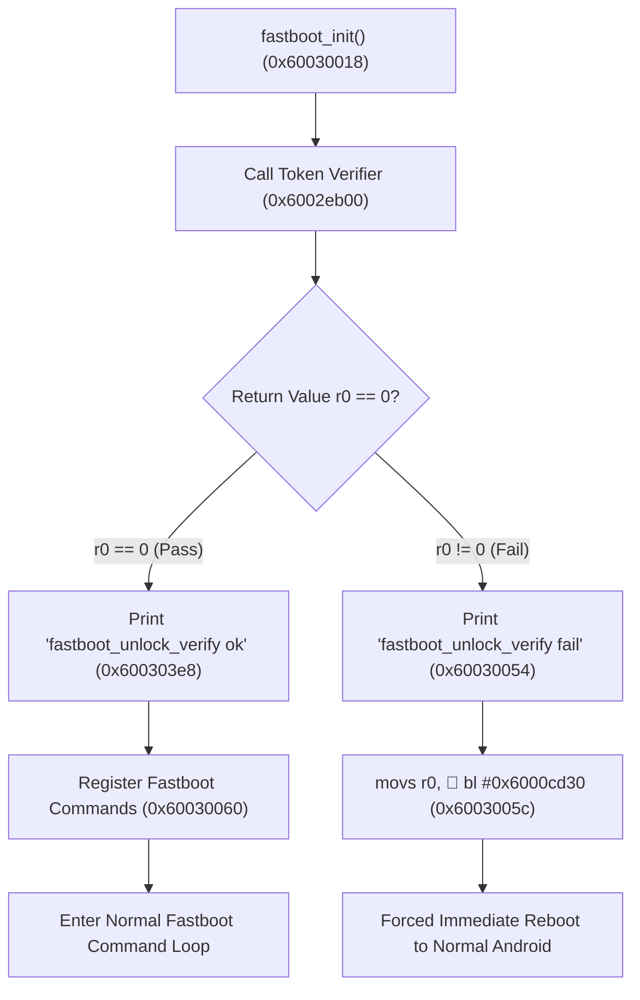

# C.49 Bootloader Binary Format & Reverse-Engineering Analysis

**Artifact ID:** ART-007  
**Firmware Version:** Realme 1 (CPH1859) ColorOS C.49 (`CPH1859EX_11_C.49_200509_868b7e2c`)  
**Target Binaries:** `lk.img`, `preloader_oppo6771_17065.bin`, `MT6771_Android_scatter.txt`  
**Analysis Date:** 2026-10-21  
**Methodology:** Read-only static container parsing and ARMv7/Thumb-2 disassembly via Python 3 and Capstone 5.0.7  

---

## 1. Verified Artifact Hashes & Sizes

| File | Size (Bytes) | Expected SHA-256 | Verified SHA-256 | Status |
|---|---:|---|---|:---:|
| `lk.img` | 753,984 | `30b48cd52b5d6035819c5580eb4a7f745010042318d1358b46a4f9fd5a37baaa` | `30b48cd52b5d6035819c5580eb4a7f745010042318d1358b46a4f9fd5a37baaa` | **MATCH** |
| `preloader_oppo6771_17065.bin` | 265,756 | `afe99890545f60ebb04158d7d327369237ea20241218c35f01f272b94ad1ee1a` | `afe99890545f60ebb04158d7d327369237ea20241218c35f01f272b94ad1ee1a` | **MATCH** |
| `MT6771_Android_scatter.txt` | 19,588 | `0be7cd2512e42c6c78e358cc1cf1d56f2fab8473f633c7fa48295c2e9fd21355` | `0be7cd2512e42c6c78e358cc1cf1d56f2fab8473f633c7fa48295c2e9fd21355` | **MATCH** |

---

## 2. Container Format Identification

### 2.1 MediaTek Image Header (`union prt_img_hdr`)
Analysis of `lk.img` establishes that it does not start with raw machine code, but rather with MediaTek's proprietary image container header (`union prt_img_hdr` / `union_header`). This 512-byte header is standard across MediaTek ROM images (such as `boot.img`, `recovery.img`, `logo.bin`, and `md1img.img`).

The container structure is defined in MediaTek BSP code as follows:

```c
#define IMG_MAGIC     0x58881688
#define EXT_MAGIC     0x58891689
#define IMG_NAME_SIZE 32
#define IMG_HDR_SIZE  512

union prt_img_hdr {
    struct {
        unsigned int magic;          /* 0x00: 0x58881688 (IMG_MAGIC) */
        unsigned int dsize;          /* 0x04: Payload size excluding header & padding */
        char         name[32];       /* 0x08: Null-terminated image identifier string */
        unsigned int maddr;          /* 0x28: Target memory load address (or 0xffffffff) */
        unsigned int mode;           /* 0x2c: Image mode / execution flags */
        unsigned int ext_magic;      /* 0x30: 0x58891689 (EXT_MAGIC) */
        unsigned int hdr_size;       /* 0x34: Header size (0x200 / 512 bytes) */
        unsigned int hdr_version;    /* 0x38: Header structure version (0x1) */
        unsigned int img_type;       /* 0x3c: Image type specifier */
    } info;
    unsigned char padding[512];      /* Padded to fixed 512-byte block */
};
```

### 2.2 Image Header Parsing & Layout Map
`lk.img` is a concatenated multi-section container containing three distinct MediaTek image headers: the main Little Kernel executable, followed by two OEM security certificates (`cert1` and `cert2`).

```
0x00000000 +------------------------------------------+
           | Header #1: 'lk' (512 bytes)              |
           | Magic: 0x58881688 | dsize: 0x000b70cc    |
0x00000200 +------------------------------------------+
           | LK Executable Payload                    |
           | ARMv7 Exception Vectors & Bootstrap      |
           | Length: 0x000b70cc (749,772 bytes)       |
           | Target RAM: 0x60000000 - 0x600b70cc      |
0x000b72cc +------------------------------------------+
           | 4-byte zero padding (alignment)          |
0x000b72d0 +------------------------------------------+
           | Header #2: 'cert1' (512 bytes)           |
           | Magic: 0x58881688 | dsize: 0x000006ad    |
0x000b74d0 +------------------------------------------+
           | Certificate 1 Payload (1,709 bytes)      |
0x000b7b7d +------------------------------------------+
           | 3-byte zero padding                      |
0x000b7b80 +------------------------------------------+
           | Header #3: 'cert2' (512 bytes)           |
           | Magic: 0x58881688 | dsize: 0x000003b1    |
0x000b7d80 +------------------------------------------+
           | Certificate 2 Payload (945 bytes)        |
0x000b8131 +------------------------------------------+
           | 15-byte zero padding                     |
0x000b8140 +------------------------------------------+ (EOF: 753,984 bytes)
```

#### Detailed Header Field Values

1. **Header #1 (`lk`)** (File offset `0x00000000`):
   - `magic`: `0x58881688`
   - `dsize`: `0x000b70cc` (749,772 bytes)
   - `name`: `"lk"`
   - `maddr`: `0xffffffff`
   - `mode`: `0xffffffff`
   - `ext_magic`: `0x58891689`
   - `hdr_size`: `0x00000200` (512 bytes)
   - `hdr_version`: `0x00000001`
   - `img_type`: `0x00000000`

2. **Header #2 (`cert1`)** (File offset `0x000b72d0`):
   - `magic`: `0x58881688`
   - `dsize`: `0x000006ad` (1,709 bytes)
   - `name`: `"cert1"`
   - `maddr`: `0x12345678`
   - `mode`: `0xffffffff`
   - `ext_magic`: `0x58891689`
   - `hdr_size`: `0x00000200` (512 bytes)
   - `hdr_version`: `0x00000001`
   - `img_type`: `0x02000000`

3. **Header #3 (`cert2`)** (File offset `0x000b7b80`):
   - `magic`: `0x58881688`
   - `dsize`: `0x000003b1` (945 bytes)
   - `name`: `"cert2"`
   - `maddr`: `0x12345678`
   - `mode`: `0xffffffff`
   - `ext_magic`: `0x58891689`
   - `hdr_size`: `0x00000200` (512 bytes)
   - `hdr_version`: `0x00000001`
   - `img_type`: `0x02000002`

### 2.3 Preloader Container Format
`preloader_oppo6771_17065.bin` uses the MediaTek Generic Firmware Header (GFH) format:
- Magic sequence at offset `0x000`: `4d 4d 4d 01` (`MMM\x01` / `0x014d4d4d`).
- Section identifier: `FILE_INFO`.
- Vector table entry at offset `0x0f4`: `05 00 00 ea` (`b #0x110`).

---

## 3. Architecture, Endianness & Runtime Memory Map

### 3.1 Target Architecture & Instruction Set Transitions
- **Processor Architecture:** ARMv7-A (32-bit Cortex-A53 executing in AArch32 state).
- **Endianness:** Little Endian (`<I`).
- **Target Load Base Address:** `0x60000000` in DRAM.
- **Payload Boundaries:**
  - File offset: `0x00000200` to `0x000b72cc`.
  - Memory range: `0x60000000` to `0x600b70cc` (749,772 bytes).
- **Execution States:**
  - Bootstrap: Runs in **32-bit ARM state** from `0x60000000` (file `0x200`) to `0x60000114` (file `0x314`).
  - Kernel & Applications: Transitions to **Thumb-2 state** at `0x60000110` (file `0x310`) via `blx #0x6002a944` into `kmain()`.

### 3.2 Bootstrap Disassembly & Self-Relocation Logic
Disassembly of the first 40 instructions at file offset `0x200` confirms the runtime load address and hardware initialization:

```armasm
; --- ARM Exception Vectors (Runtime 0x60000000 / File 0x000200) ---
0x60000000:  07 00 00 ea   b        #0x60000024       ; Reset vector -> bootstrap
0x60000004:  2c a5 00 ea   b        #0x600296bc       ; Undefined instruction handler
0x60000008:  32 a5 00 ea   b        #0x600296d8       ; Software interrupt (SVC) handler
0x6000000c:  38 a5 00 ea   b        #0x600296f4       ; Prefetch abort handler
0x60000010:  3e a5 00 ea   b        #0x60029710       ; Data abort handler
0x60000014:  44 a5 00 ea   b        #0x6002972c       ; Reserved
0x60000018:  44 a5 00 ea   b        #0x60029730       ; IRQ handler
0x6000001c:  5b a5 00 ea   b        #0x60029790       ; FIQ handler

; --- Reset Bootstrap Routine (0x60000024 / File 0x000224) ---
0x60000024:  44 60 9f e5   ldr      r6, [pc, #0x44]   ; r6 = [0x60000070] = 0x60000020
0x60000028:  00 40 86 e5   str      r4, [r6]          ; Store preloader arg r4 at 0x60000020
0x6000002c:  10 0f 11 ee   mrc      p15, #0, r0, c1, c0, #0 ; Read CP15 SCTLR
0x60000030:  0b 0a c0 e3   bic      r0, r0, #0xb000   ; Disable I-cache, rounding, branch prediction
0x60000034:  05 00 c0 e3   bic      r0, r0, #5        ; Disable MMU and D-cache
0x60000038:  02 00 80 e3   orr      r0, r0, #2        ; Strict alignment fault checking enabled
0x6000003c:  10 0f 01 ee   mcr      p15, #0, r0, c1, c0, #0 ; Write CP15 SCTLR

; --- Self-Relocation Check (0x60000040 / File 0x000240) ---
0x60000040:  0f 00 a0 e1   mov      r0, pc            ; r0 = current PC
0x60000044:  48 00 40 e2   sub      r0, r0, #0x48     ; r0 = base address where binary was loaded
0x60000048:  24 10 9f e5   ldr      r1, [pc, #0x24]   ; r1 = [0x60000074] = 0x60000000 (Target Base)
0x6000004c:  01 00 50 e1   cmp      r0, r1            ; Already running at 0x60000000?
0x60000050:  0a 00 00 0a   beq      #0x60000080       ; Yes -> skip relocation

; --- Copy Loop (if loaded at unexpected DRAM offset) ---
0x60000054:  1c 20 9f e5   ldr      r2, [pc, #0x1c]   ; r2 = [0x60000078] = 0x600b70cc (End of payload)
0x60000058:  04 30 90 e4   ldr      r3, [r0], #4
0x6000005c:  04 30 81 e4   str      r3, [r1], #4
0x60000060:  02 00 51 e1   cmp      r1, r2
0x60000064:  fb ff ff 1a   bne      #0x60000058
0x60000068:  0c 00 9f e5   ldr      r0, [pc, #0xc]    ; r0 = [0x6000007c] = 0x60000080
0x6000006c:  10 ff 2f e1   bx       r0                ; Jump into relocated code

; --- Stack Setup across ARM Modes (0x60000080 / File 0x000280) ---
0x60000080:  00 00 0f e1   mrs      r0, apsr
0x60000084:  1f 00 c0 e3   bic      r0, r0, #0x1f
0x60000088:  88 20 9f e5   ldr      r2, [pc, #0x88]   ; r2 = 0x600ba000 (General stack top)
0x6000008c:  12 10 80 e3   orr      r1, r0, #0x12     ; IRQ Mode
0x60000090:  01 f0 21 e1   msr      cpsr_c, r1
0x60000094:  80 d0 9f e5   ldr      sp, [pc, #0x80]   ; sp_irq = 0x600c07e0
...
0x600000c8:  13 10 80 e3   orr      r1, r0, #0x13     ; Supervisor Mode (SVC)
0x600000cc:  01 f0 21 e1   msr      cpsr_c, r1
0x600000d0:  02 d0 a0 e1   mov      sp, r2            ; sp_svc = 0x600ba000

; --- BSS Section Zeroing (0x600000f8 / File 0x0002f8) ---
0x600000f8:  2c 00 9f e5   ldr      r0, [pc, #0x2c]   ; r0 = 0x600b70cc (__bss_start)
0x600000fc:  2c 10 9f e5   ldr      r1, [pc, #0x2c]   ; r1 = 0x600dd9d4 (__bss_end)
0x60000100:  00 20 a0 e3   mov      r2, #0
0x60000104:  01 00 50 e1   cmp      r0, r1
0x60000108:  04 20 80 b4   strlt    r2, [r0], #4
0x6000010c:  fc ff ff ba   blt      #0x60000104

; --- Mode Switch: ARM to Thumb-2 (0x60000110 / File 0x000310) ---
0x60000110:  0b aa 00 fa   blx      #0x6002a944       ; Jump to kmain() in Thumb state!
0x60000114:  fe ff ff ea   b        #0x60000114       ; Infinite loop if kmain returns
```

---

## 4. Reverse-Engineering Landmark Analysis

### 4.1 Address Translation Formula
Because the executable payload begins at file offset `0x200` and executes at base `0x60000000`:
$$\text{RAM Address} = \text{File Offset} - \text{0x200} + \text{0x60000000}$$
$$\text{File Offset} = \text{RAM Address} - \text{0x60000000} + \text{0x200}$$

### 4.2 Verified String Landmark Table

| String Content | File Offset | RAM Address | Function / Module Context |
|---|---:|---:|---|
| `the serial is not match` | `0x80504` | `0x60080304` | Serial number comparison in token check |
| `oppo Verify pass` | `0x8051c` | `0x6008031c` | Successful signature validation |
| `oppo Verify fail` | `0x80530` | `0x60080330` | Signature or token validation failure |
| `fastboot_unlock_verify fail` | `0x80bfc` | `0x600809fc` | `fastboot_init()` abort failure message |
| `fastboot_unlock_verify ok` | `0x80c1c` | `0x60080a1c` | `fastboot_init()` success pass message |
| `flashing unlock` | `0x80e14` | `0x60080c14` | Command registration string |
| `flashing lock` | `0x80e30` | `0x60080c30` | Command registration string |
| `flashing get_unlock_ability` | `0x80e40` | `0x60080c40` | Command registration string |
| `frp` | `0x836c8` | `0x600834c8` | Target partition for `unlock_ability` flag |
| `unlock_allowed_flag_offset: 0x%llx` | `0x8370c` | `0x6008350c` | Offset print in `get_unlock_permission()` |
| `Failed to get unlock permission - Err:0x%x` | `0x83a85` | `0x60083885` | FRP partition read failure in fastboot |
| `unlock_ability = %d` | `0x83ab0` | `0x600838b0` | Fastboot get_unlock_ability return string |
| `Start unlock flow` | `0x83b28` | `0x60083928` | User-approved flashing unlock initiated |
| `Unlock operation is not allowed` | `0x83b81` | `0x60083981` | Rejection when `unlock_ability == 0` |
| `Unlock Pass...return to fastboot in 3s` | `0x83bde` | `0x600839de` | Successful bootloader unlock completion |

---

## 5. Control Flow: Bootloader Unlock & Permission Logic

### 5.1 Gatekeeper 1: Fastboot Entry Verification (`fastboot_unlock_verify`)
The gatekeeper that prevents entering fastboot mode on factory devices is located in `fastboot_init()` at `0x60030018`.



#### Verification Function `0x6002eb00` Disassembly & Operational Breakdown:
- **Stack Allocation:** `sub.w sp, sp, #0x1580` allocates a 5.5 KB frame on the stack.
- **Hardware Serial Read:** Invokes `0x60000140` and `0x60030888` to query the SoC efuse board serial number into a 16-byte buffer (`r6 = [sp, #0x2c]`).
- **Token Storage Partition & Sector Offset:**
  - Calls `0x6002c794` (`read_reserve4`) with parameters: `r0 = [sp, #0x20]` (buffer), `r1 = 0x16` (sector offset 22 relative to reserve4 sub-block), `r2 = 8` (8 sectors = 4,096 bytes).
  - Target partition: `"reserve4"` (read from string table at RAM `0x6005e220`).
  - **Internal Sector Offset Math:** Inside `0x6002c794`, instruction `0x6002c79a: add.w r1, r1, #0x7800` adds the base sector `0x7800` (30,720 sectors = 15 MB) to parameter `r1 = 0x16`, giving the **actual sector offset `0x7816`** (30,742 sectors).
  - **Actual Byte Offset:** `0x7816 * 512 = 0x00f02c00` bytes (15,740,416 bytes = ~15.01 MB into partition `reserve4`).
  - If read returns non-zero error: branches to `0x6002ed8e`, outputs `"Unable read emmc: %r\n"` (`0x600802dc`), and returns error.
- **Board Serial Comparison:**
  - Executes `memcmp` (`0x60039e78`) at `0x6002ec3c` comparing 16 bytes of the hardware board serial against the token buffer at `sp + 0x688`.
  - Fallback check: If the primary 16-byte check fails, inspects `[buffer + 0x100]` for ASCII `'0'` (`0x30`) and compares 15 bytes against `sp + 0x689`.
  - Mismatch branch (`0x6002ed9e`): If neither matches, outputs `"the serial is not match\n"` (`0x600802f8`) and returns `-1`.
- **Cryptographic Signature Verification:**
  - Hash algorithm: SHA-256 (`0x60058250`, digest size 32 bytes / `0x20`). The verifier hashes the 16-byte token serial field after the serial comparison; in the ordinary case this equals the eFUSE-derived serial text.
  - Signature algorithm: RSA-2048 RSASSA-PSS with MGF1-SHA-256, salt length 32, and trailer `0xBC` (`0x600567c0`, key modulus 2048 bits / `0x800`, signature size 256 bytes / `0x100`). It is not PKCS#1 v1.5.
  - **Public Key Modulus Location:** Embedded directly in `.rodata` of `lk.img` at RAM **`0x6007ee48`** (file offset `0x7f048`). The address is referenced via pointer `0x600b6b18` in `.data`, loaded at `0x6002ecde: ldr r1, [pc, #0xd4]`.
  - Pass branch (`0x6002ed5a`): Outputs `"oppo Verify pass\n"` (`0x6008031c`) and returns `0`.
  - Fail branch (`0x6002ed50`): Outputs `"oppo Verify fail\n"` (`0x60080330`), sets return code `-3` (`0xfffffffd`), and exits.
- **Fastboot Abort Trigger:**
  - When `0x6002eb00` returns non-zero (`-1` or `-3`), `fastboot_init()` at `0x60030050` outputs `"fastboot_unlock_verify fail\n\n"` (`0x600809fc`).
  - At `0x6003005c`, it calls `0x6000cd30` (`[WDT] mtk_arch_reset`), which writes magic `0x1971` to the MediaTek Watchdog Timer reset register (`0x10007000` / `0x10007008`), triggering an immediate hardware reset into normal ColorOS.

#### Relocking & Token Clearing: `clean_flash_unlock_data()`
- **Function Location:** RAM `0x6002eacc` | File offset `0x2ecc`
- **Disassembly:**
  ```armasm
  0x6002eacc:  push     {r4, lr}
  0x6002eace:  sub.w    sp, sp, #0x1000   ; Allocates 4096-byte (4 KB) buffer
  0x6002ead2:  movs     r1, #0
  0x6002ead4:  mov.w    r2, #0x1000
  0x6002ead8:  mov      r0, sp
  0x6002eada:  blx      #0x60039db4       ; memset(sp, 0, 4096)
  0x6002eade:  mov      r0, sp
  0x6002eae0:  movs     r1, #0x16         ; Sector offset 0x16 (actual 0x7816)
  0x6002eae2:  movs     r2, #8            ; 8 sectors (4096 bytes)
  0x6002eae4:  bl       #0x6002c7d4       ; write_reserve4(buf, sector=0x16, count=8)
  0x6002eae8:  mov      r4, r0
  0x6002eaea:  cbz      r0, #0x6002eaf4
  0x6002eaec:  ldr      r0, [pc, #0xc]    ; "clean_flash_unlock_data fail!\n" (0x6008029c)
  0x6002eaee:  add      r0, pc
  0x6002eaf0:  bl       #0x60038b7c
  0x6002eaf4:  mov      r0, r4
  0x6002eaf6:  add.w    sp, sp, #0x1000
  0x6002eafa:  pop      {r4, pc}
  ```
- **Caller Context & Failure Conditions:**
  - `clean_flash_unlock_data()` is called **strictly from `0x60036920`** inside `cmd_flashing_lock()`.
  - It is reached **only when the user executes `fastboot flashing lock` and confirms relocking on-screen**.
  - It is **never called during token verification failure**.
- **Destructive Side Effects Assessment:**
  - Zero destructive side effects on user data, recovery, or operating system partitions.
  - Its scope is strictly confined to overwriting the 4,096-byte unlock token at sector `0x7816` of partition `reserve4` with zero bytes, ensuring the device returns to an un-tokenized locked state.

### 5.2 Gatekeeper 2: Permission Query (`flashing get_unlock_ability`)
- Handler address: `0x60036518` (Thumb entry `0x60036519`).
- Control flow:
  1. Calls `0x60036390` (`get_unlock_permission`).
  2. `0x60036390` accesses the `"frp"` partition (`0x600834c8`), queries its size via `0x6004d5ac`, and calculates offset:
     $$\text{Flag Offset} = \text{Partition Size} - 4$$
  3. Reads 4 bytes from `frp` at `Flag Offset` into `[sp, #4]`.
  4. If read succeeds: formats `unlock_ability = %d` and returns `OKAY`.
  5. If read fails: formats `Failed to get unlock permission - Err:0x%x` and returns `FAIL`.

### 5.3 Gatekeeper 3: Unlock Execution (`flashing unlock`)
- Handler address: `0x60036648` (Thumb entry `0x60036649`).
- Control flow:
  1. Displays the unlock confirmation warning on the screen (`0x60036408`):
     *"Unlock bootloader? If you unlock the bootloader, you will be able to install custom operating system software... Volume UP: Unlock. Volume Down: Do not unlock."*
  2. Polls key state (`bl #0x600519d4` / `bl #0x60005cb8`).
  3. If **Volume Down** (Reject): prints timeout message, sleeps 3000ms (`0x6004fb74`), returns `OKAY`.
  4. If **Volume Up** (Confirm):
     - Prints `"Start unlock flow"` (`0x60083928`).
     - Calls `0x60036390` to read `unlock_ability` from `frp`.
     - If `unlock_ability == 0`: prints `Unlock operation is not allowed` (`0x60083981`) and aborts with `FAIL`.
     - If `unlock_ability != 0`:
       - Invokes `0x6004db18` (`unlock_erase`), wiping `userdata`.
       - Invokes `0x6005576c` to write the unlocked state flag into persistent security storage (`seccfg`).
       - Prints `"Unlock Pass...return to fastboot in 3s"` (`0x600839de`).
       - Sleeps 3000ms and returns `OKAY`.

---

## 6. Verified Facts vs. Hypotheses

### 6.1 Verified Facts (Empirically Proven)
1. **Container Headers:** `lk.img` uses MediaTek's 512-byte `prt_img_hdr` container format with magic `0x58881688` / `0x58891689`, wrapping a 749,772-byte payload, followed by two separate 512-byte cert containers (`cert1` and `cert2`).
2. **Payload Entry & Architecture:** The Little Kernel is 32-bit ARMv7-A Little Endian, loaded and executed at base DRAM address `0x60000000`. It initializes hardware in ARM mode and switches to Thumb-2 mode at `kmain()` (`0x6002a944`).
3. **Fastboot Lockout Mechanism:** Fastboot mode is not blocked by a missing partition; it is blocked by an explicit hardware efuse serial validation function (`0x6002eb00`) in `fastboot_init()`.
4. **OEM Unlock Flag Location:** The `unlock_ability` flag is read directly from offset `partition_size - 4` of the `frp` partition.

### 6.2 Questions That Remain Open
1. **Exact installed-image provenance:**
   - The accessible C.50 LK and preloader references match the recorded hashes and are code-identical to the C.49 references in the analyzed regions.
   - Project provenance identifies the C.50 package as CPH1861-targeted. It must not be called the exact installed CPH1859 firmware without an independently model-authenticated package.
2. **Proprietary In-Depth Test Server Protocol:**
   - While the on-device token structure (4 KB in `reserve4`, 16-byte token serial, 256-byte signature) is established, the exact network protocol, endpoint parameters, and cryptographic challenge-response exchanged with the historical Oppo service cannot be reconstructed from bootloader code alone.

### 6.3 Hardware Project Compatibility: CPH1859 vs CPH1861 vs Project 17065
- **Common Software Project Architecture:** `Projectconfig.xml` establishes that the underlying BSP project is `oppo6771_17065`, serving as the `Common_software_project` across variants `17061`, `17065`, `17066`, `27065`, and `27066`.
- **Live Device Posture:** The target device reports:
  - `ro.product.model = CPH1859`
  - `ro.separate.soft = 17066`
  - `vendor.gsm.project.baseband = OPPO6771_17065(LWCTG_CUSTOM)`
  - `vendor.oppo.camera.project = 17061`
- **Audit Finding:** The C.49 `lk.img` binary is compiled from the unified `oppo6771_17065` Little Kernel codebase. None of the reverse-engineering findings rely on assumptions about differences between CPH1859 and CPH1861; they are directly applicable to the common `17065` bootloader binary running across all Realme 1 hardware sub-models.

---

## 7. Recommended Static Disassembly Toolset

No heavy or proprietary reverse-engineering suites are necessary on Linux Mint:
1. **Python 3.13 Standard Library:** Built-in `struct`, `binascii`, and `os` modules for container header parsing and literal-pool resolution.
2. **Capstone Engine (5.0.7):** Already present in the host Python environment (`/home/ameya/.pyenv/versions/3.13.16/lib/python3.13/site-packages/capstone`). Provides lightweight, multi-architecture disassembly supporting both ARM mode (`CS_MODE_ARM`) and Thumb-2 mode (`CS_MODE_THUMB`).
3. **Reproducibility:** Requires zero root privileges and generates deterministic outputs.

---

## 8. Reproducible Read-Only Validation Commands

Execute these commands from any terminal to reproduce the findings:

```bash
# 1. Verify SHA-256 Hashes
sha256sum /home/ameya/Realme1/C49_extracted/lk.img \
          /home/ameya/Realme1/C49_extracted/preloader_oppo6771_17065.bin

# 2. Parse MediaTek Container Headers
python3 -c "
import struct
with open('/home/ameya/Realme1/C49_extracted/lk.img', 'rb') as f:
    for off in [0x0, 0xb72d0, 0xb7b80]:
        f.seek(off)
        m1, dsz, name, maddr, mode, m2, hsz, hver, itype = struct.unpack('<II32sIIIIII', f.read(64))
        print(f'Offset 0x{off:x}: name={name.split(b\"\x00\")[0].decode()} magic=0x{m1:08x} dsize={dsz} hdr_size={hsz}')
"

# 3. Disassemble Vector Table & Bootstrap Reset
python3 -c "
import capstone
with open('/home/ameya/Realme1/C49_extracted/lk.img', 'rb') as f:
    f.seek(0x200)
    code = f.read(0x48)
md = capstone.Cs(capstone.CS_ARCH_ARM, capstone.CS_MODE_ARM)
for i in md.disasm(code, 0x60000000):
    print(f'0x{i.address:08x}:  {i.mnemonic:<8} {i.op_str}')
"

# 4. Disassemble Fastboot Verification Gatekeeper
python3 -c "
import capstone
with open('/home/ameya/Realme1/C49_extracted/lk.img', 'rb') as f:
    f.seek(0x60030040 - 0x60000000 + 0x200)
    code = f.read(0x24)
md = capstone.Cs(capstone.CS_ARCH_ARM, capstone.CS_MODE_THUMB)
for i in md.disasm(code, 0x60030040):
    print(f'0x{i.address:08x}:  {i.mnemonic:<8} {i.op_str}')
"

# 5. Inspect reserve4 Sector Offset Math (0x7800 + 0x16 = 0x7816)
python3 -c "
import capstone
with open('/home/ameya/Realme1/C49_extracted/lk.img', 'rb') as f:
    f.seek(0x6002c794 - 0x60000000 + 0x200)
    code = f.read(0x1a)
md = capstone.Cs(capstone.CS_ARCH_ARM, capstone.CS_MODE_THUMB)
for i in md.disasm(code, 0x6002c794):
    print(f'0x{i.address:08x}:  {i.mnemonic:<8} {i.op_str}')
"

# 6. Verify Embedded 2048-Bit RSA Public Key Modulus
python3 -c "
with open('/home/ameya/Realme1/C49_extracted/lk.img', 'rb') as f:
    f.seek(0x6007ee48 - 0x60000000 + 0x200)
    modulus = f.read(256)
print(f'RSA Modulus (256 bytes / 2048 bits): {modulus[:32].hex()}...')
"

# 7. Disassemble clean_flash_unlock_data Caller in cmd_flashing_lock
python3 -c "
import capstone
with open('/home/ameya/Realme1/C49_extracted/lk.img', 'rb') as f:
    f.seek(0x60036916 - 0x60000000 + 0x200)
    code = f.read(0x18)
md = capstone.Cs(capstone.CS_ARCH_ARM, capstone.CS_MODE_THUMB)
for i in md.disasm(code, 0x60036916):
    print(f'0x{i.address:08x}:  {i.mnemonic:<8} {i.op_str}')
"
```
