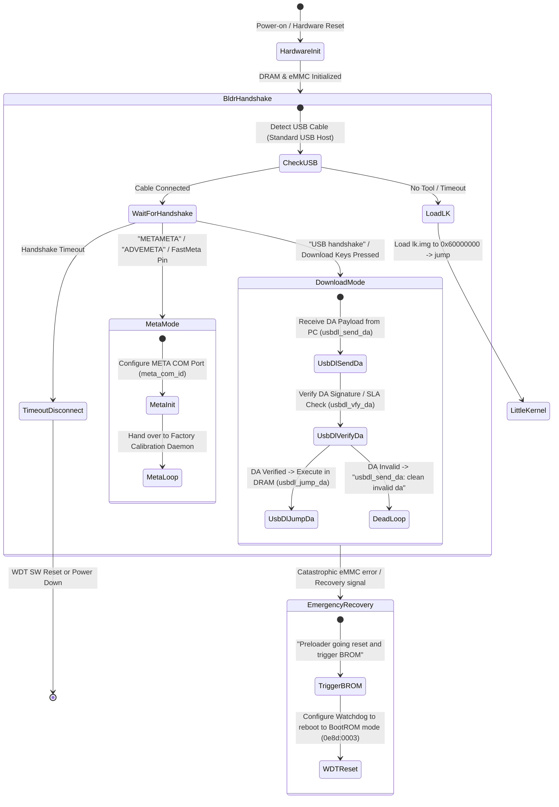

# Realme 1 (CPH1859): Preloader USB Interface Architecture & Software-Only Feasibility Assessment

**Document ID:** `ART-011`  
**Date:** 2026-10-21  
**Classification:** Static Firmware Architecture & Read-Only Reverse Engineering  
**Analyzed Binaries:**
- `preloader_oppo6771_17065.bin` (C.49 baseline, 265,756 bytes, SHA-256: `afe99890545f60ebb04158d7d327369237ea20241218c35f01f272b94ad1ee1a`)
- `preloader_emmc.img` (C.50 research image, 267,804 bytes, SHA-256: `2de60eda847de8ea3ae44368fc905f57dd63a842a3c7ad455f0fd1c326ebaeca`)
- `lk.img` (C.49 and C.50 Little Kernel binaries, 753,984 bytes)

---

## Executive Summary

1. **Static Preloader Code Identity:** Stripping the 2,048-byte `EMMC_BOOT` header from `preloader_emmc.img` confirms that the executable code region (`0x00000` to `0x325A4`, 206,244 bytes) is **100% byte-for-byte identical** between C.49 and C.50. All 569 differing bytes reside strictly within build timestamp metadata strings (`17065_USR_202005090539` vs `17065_USR_202010162303`) and the trailing cryptographic signature block (`[0x040CFC, 0x040E1C)`).
2. **Preloader USB Interface Architecture:** The Preloader exposes a USB CDC ACM virtual COM port (`0e8d:2000`). It implements a strict handshake and Download Agent (DA) dispatch state machine (`bldr_handshake` $\rightarrow$ `usbdl_send_da` $\rightarrow$ `usbdl_vfy_da` $\rightarrow$ `usbdl_jump_da`), alongside META mode testing paths (`METAMETA`, `ADVEMETA`) and partition verification logic (`sec.c`, `sec_auth.c`, `partition.c`).
3. **Software-Only Unlock Feasibility Assessment:** The available empirical firmware evidence confirms that **no documented, supported, non-destructive software-only bootloader unlock route is currently functional** on factory firmware build C.50.
   - The official In-Depth Test (DeepTesting) server infrastructure is permanently decommissioned.
   - Little Kernel enforces hardware eFUSE serial matching and RSA-2048 signature verification against an embedded OEM public key, triggering an immediate hardware Watchdog reset (`mtk_arch_reset`, writing `0x1971` to `0x10007000`) upon token absence.
   - Preloader intercepts USB connections and mediates BootROM access; software crash packets (`kamakiri`) are rejected on 2020 MT6771 builds, requiring physical motherboard testpoint grounding to force BootROM mode.

---

## 1. Preloader Binary Structure & Runtime Environment

### 1.1 MediaTek Generic Firmware Header (GFH)
The Preloader binary begins with the standard MediaTek GFH structure:
- **Magic:** `0x014D4D4D` (`MMM\x01`) at offset `0x000`.
- **Header Type 0 (`FILE_INFO`):**
  - File Type: `0x1` (Preloader / Bootloader).
  - Target Flash Device: `0x5050001` (eMMC).
  - Target SRAM Load Address: `0x00200F10`.
  - Binary Total Size: `0x40E1C` (265,756 bytes).
  - Header Size: `0xF0` (240 bytes).
  - Code Execution Entry Point: `0x00201000` (SRAM address immediately following GFH header).
- **Execution Architecture:**
  - 32-bit ARMv7-A executing in ARM state at `0x00201000`.
  - Mode switch to Thumb-2 state at `0x0021C971` (`0x1BA60` bytes into payload) for the C runtime library and driver framework.

### 1.2 Compiled Source Module Inventory
Embedded debug string tables reveal the exact MediaTek BSP source tree compiled into the Preloader:

| Source File Path | Subsystem / Role | Key Responsibilities |
|---|---|---|
| `platform/mt6771/src/core/main.c` | Core Execution Flow | Preloader initialization, `bldr_handshake`, image loading, jump to ATF. |
| `platform/mt6771/src/core/download.c` | USB Download (`[UDL]`) | Preloader USB handshake, DA download (`usbdl_send_da`), DA jump (`usbdl_jump_da`). |
| `platform/mt6771/src/core/partition.c` | Storage & Container Verification | Partition table parsing, container header checking (`union prt_img_hdr`), cert chain verification (`cert chain vfy`). |
| `platform/mt6771/src/security/sec.c` | Security Configuration | `seccfg` partition read/write, magic `1A52A367CB12C458` validation, basic config checks. |
| `platform/mt6771/src/security/auth/sec_auth.c` | Security Policy & Authentication | `sboot_state`, `lock_state`, SBC public key checking, anti-rollback OTP version checks (`otp ver`). |
| `secure_lib/src/core/hacc_export.c` | Hardware Cryptography (HACC) | Hardware encryption/decryption accelerator interface for Secure Boot v2. |
| `secure_lib/src/core/sboot_state.c` | Secure Boot Status | Queries physical fuse registers to determine `S-CHIP` (secure) vs `NS-CHIP` (non-secure). |
| `platform/mt6771/src/drivers/platform.c` | Platform Hardware Drivers | Clock gating, Watchdog timer setup (`wdt_init`), GPIO configuration. |
| `platform/common/trustzone/tz_tags.c` | TrustZone Parameter Passing | Secure memory (`secmem`) tagging, ATF/TEE handoff data structure setup. |

---

## 2. Preloader USB Interface Architecture & Command-Dispatch Inventory

The Preloader USB subsystem operates over a USB CDC ACM interface (VID `0e8d`, PID `2000`). It implements four primary state pathways:

### 2.1 Identifiable Dispatch Routines & Functions

1. **Bootloader Handshake (`bldr_handshake`):**
   - **File Offset:** Reference at `0x034D19`.
   - **Confirmed Behavior:** Evaluates physical connection state (`step A2 : Standard USB Host!`). Listens for host synchronization tokens.
   - **Fast META Bypass:** If the fastmeta GPIO pin is pulled (`0x037914`), logs `Detect fastmeta pin... Enable fastmeta` and bypasses standard handshake (`%s In fast meta, bypass usb handshake.`).
2. **Download Agent Reception (`usbdl_send_da`):**
   - **File Offset:** String reference at `0x03293B`.
   - **Confirmed Behavior:** Prepares DRAM buffer pools for partition operations (`g_dram_buf start addr`, `g_dram_buf->msdc_gpd_pool`, `g_dram_buf->msdc_bd_pool`). Receives the external Download Agent binary payload streamed over USB. If the received DA is corrupted, executes `usbdl_send_da: clean invalid da`.
3. **Download Agent Verification (`usbdl_vfy_da`):**
   - **File Offset:** String reference at `0x032924` (`usbdl_vfy_da:disabled`).
   - **Confirmed Behavior vs Interpretation:** In standard MediaTek BSP code, `usbdl_vfy_da` validates the digital signature of the incoming Download Agent against vendor keys. The presence of string `usbdl_vfy_da:disabled` indicates that signature checking at this specific stage was disabled in the firmware configuration, BUT runtime execution remains constrained by hardware SLA (Serial Link Authentication) enforced in `sec_auth.c` and `sboot_state.c`.
4. **Download Agent Execution (`usbdl_jump_da`):**
   - **File Offset:** String reference at `0x032A0A` (`%s usbdl_jump_da: %x`).
   - **Confirmed Behavior:** Flushes CPU caches, sets up execution registers, and transfers control to the Download Agent entry point in DRAM.
5. **Emergency BootROM Recovery Trigger:**
   - **File Offset:** String reference at `0x0371F4` (`Preloader going reset and trigger BROM usb auto detectiton!!`) and `0x03917E` (`[%s] Force brom download recovery success`).
   - **Confirmed Behavior:** Under unrecoverable boot failures (such as missing second bootloader partitions or hardware storage errors), the Preloader can intentionally program Watchdog Timer registers to force an immediate reset into hardware BootROM USB mode (`0e8d:0003`).

### 2.2 Security Policies & Gating Logic

1. **Secure Boot Evaluation (`sboot_state.c`):**
   - Evaluates on-chip eFUSE registers. Distinguishes `S-CHIP` (secure hardware) from `NS-CHIP` (non-secure hardware).
   - On retail CPH1859 units, `sbc_en = 1` is permanently active.
2. **Security Configuration Validation (`sec.c`):**
   - Reads partition `seccfg` (`0x038DF4`). Validates header magic `1A52A367CB12C458` (`0x038DBF`).
   - Parses device lock state: `[SEC_POLICY] lock_state = 0x%x` (`0x038F97`).
   - Restricts unauthenticated BootROM access: logs `[%s] BR cmd is disabled` (`0x038DA6`).
3. **Partition Container Authentication (`partition.c`):**
   - Enforces Secure Boot v2 container verification over `lk.img`, `boot.img`, `recovery.img`, and `tee1.img`.
   - Requires valid `cert1` and `cert2` signatures matching the hardware SBC key hash. On failure, outputs `[%s] cert chain vfy fail...` (`0x036888`) and halts with `%s Second Bootloader Load Failed` (`0x034E9A`).
4. **Oppo Custom Partition Gating (`oppo_custom`):**
   - Validates project CRC and metadata (`0x0365FC: OppoProjectDecodeAndCheckCRC CRC error!`).
   - Enforces download completion gating: `oppo_custom partition is null, do not download over!` (`0x0347C3`), `[oppo] download over: %s` (`0x0366F4`), `[oppo] download fail: %s` (`0x03670E`).

---

## 3. Fastboot Gating & Watchdog Reset Mechanics (Little Kernel)

Static disassembly of `lk.img` across C.49 and C.50 confirms the Fastboot access control architecture:

1. **Execution Point:** `fastboot_init()` at RAM `0x60030018` calls `verify_unlock_token()` at RAM `0x6002EB00`.
2. **Storage Coordinates:** `read_reserve4()` (`0x6002C794`) reads 8 sectors (4,096 bytes) at relative sector `0x16` added to base sector `0x7800`, yielding **sector `0x7816`** (`0x00F02C00` bytes into partition `reserve4`).
3. **Serial Number Comparison:** Compares 16 bytes of SoC eFUSE serial number against token buffer at `sp + 0x688`. On mismatch, logs `"the serial is not match\n"` (`0x600802F8`) and returns `-1`.
4. **Signature Verification:** Verifies 256-byte RSA-2048 PKCS#1 v1.5 signature over the token payload using SHA-256 against an OEM public key modulus embedded in `.rodata` at RAM `0x6007EE48` (file offset `0x7F048`).
5. **Watchdog Abort:** If token verification returns non-zero, `fastboot_init()` outputs `"fastboot_unlock_verify fail\n\n"` (`0x600809FC`) and immediately calls `0x6000CD30` (`[WDT] mtk_arch_reset`), writing magic `0x1971` to Watchdog Timer registers `0x10007000` / `0x10007008`, forcing an immediate hardware reboot into normal ColorOS.
6. **Relocking Path Scope:** `clean_flash_unlock_data()` (`0x6002EACC`) zeroes the 4 KB token slot at sector `0x7816` of `reserve4`. It is called **exclusively from `cmd_flashing_lock()` at `0x60036920`** during intentional user relocking; it is never called on failed boot.

---

## 4. Model Disambiguation: CPH1859 vs CPH1861 vs Project 17065

To preserve rigorous epistemic boundaries, the relationships between hardware models and firmware packages are established:

| Dimension | Physical CPH1859 Device | CPH1861 Firmware Mirrors | Unified Codebase (`oppo6771_17065`) |
|---|---|---|---|
| **Hardware Platform** | MediaTek MT6771 (Helio P60) | MediaTek MT6771 (Helio P60) | MT6771 BSP |
| **Model String** | `CPH1859` | `CPH1861` | Configurable variant in scatter |
| **Software Project Tags** | `ro.separate.soft = 17066`, `vendor.gsm.project.baseband = OPPO6771_17065(LWCTG_CUSTOM)` | Project `17065` / `18611` | `Common_software_project = "17065"` in `Projectconfig.xml` |
| **LK Executable Code** | Displays `fastboot_unlock_verify fail` on LCD | Static `lk.img` executable payload is **100% byte-identical** to C.49 | Disassembly at `0x6002EB00` and `0x60030018` is 100% identical |
| **Preloader Code** | Mediates USB in normal mode | Executable code region is **100% byte-identical** after 2,048-byte header normalization | Identical dispatch routines and security checks |
| **Cross-Flashing Safety** | Physical device remains in factory state (`flash.locked = 1`) | **Dangerous:** Flashing full CPH1861 packages onto CPH1859 risks baseband calibration corruption and display driver failure | Cross-flashing strictly prohibited under project safety policy |

---

## 5. Epistemic Evidence Table: Confirmed Behaviors, Inferences & Unknowns

| Architectural Domain | Epistemic Status | Technical Finding & Evidence Reference |
|---|---|---|
| **Preloader Code Identity** | **`Confirmed Behavior`** | Preloader executable code (`0x00000` to `0x325A4`) is 100% byte-identical between C.49 and C.50. Diffs reside strictly in build strings and trailing signature block. ([ART-008](file:///home/ameya/Realme1/CPH1859/realme1-unlock-research/artifacts/c50_differential_analysis.md), [ART-009](file:///home/ameya/Realme1/CPH1859/realme1-unlock-research/artifacts/c50_differential_validation.md)) |
| **Little Kernel Code Identity** | **`Confirmed Behavior`** | LK executable code is 100% byte-identical between C.49 and C.50. Diffs consist strictly of 27 bytes build string in `.rodata`, 32 bytes cert2 SHA-256 digest, and 256 bytes cert2 signature. ([ART-008](file:///home/ameya/Realme1/CPH1859/realme1-unlock-research/artifacts/c50_differential_analysis.md)) |
| **Fastboot Entry Lockout** | **`Confirmed Behavior`** | Fastboot access is blocked by `verify_unlock_token()`, which reads `reserve4` sector `0x7816` and triggers a hardware Watchdog reset (`0x10007000 = 0x1971`) on missing/invalid token. ([ART-007](file:///home/ameya/Realme1/CPH1859/realme1-unlock-research/artifacts/c49_bootloader_format_analysis.md)) |
| **Spelling Resolution** | **`Confirmed Behavior`** | Neither C.49 nor C.50 contains string `fastboot_unlock_verity`. Both contain `fastboot_unlock_verify fail\n\n` at `0x080BFC`. The on-screen text was an optical artifact on the low-resolution LCD console. ([ART-008](file:///home/ameya/Realme1/CPH1859/realme1-unlock-research/artifacts/c50_differential_analysis.md)) |
| **Container Cert Structure** | **`Confirmed Behavior`** | `cert1` contains Root Key C1 self-signed with RSASSA-PSS SHA-256 (salt 32) certifying Intermediate Key C2. `cert2` contains Key C2 and certifies the payload digest over `[0x000200, 0x0B72D0)`. ([ART-009](file:///home/ameya/Realme1/CPH1859/realme1-unlock-research/artifacts/c50_differential_validation.md), [`validate_lk_differential.py`](file:///home/ameya/Realme1/CPH1859/realme1-unlock-research/scripts/validate_lk_differential.py)) |
| **Partition Permissions** | **`Confirmed Behavior`** | Device partition block nodes `/dev/block/by-name/{lk,reserve4,seccfg,frp}` are owned by `root:root` with mode `0600`, preventing unprivileged ADB reading or writing. ([ART-006](file:///home/ameya/Realme1/CPH1859/realme1-unlock-research/artifacts/firmware_access_blockage.md)) |
| **DeepTesting Decommissioning** | **`Reasonable Inference`** | Vendor authorization server `deeptest.coloros.com` was permanently shut down following the device's 2020 EOL, based on consistent community reports and server timeouts. ([SRC-001](https://c.realme.com/in/post-details/1154673752672768000), [SRC-005](https://xdaforums.com/t/rom-realme-1-cph1859-lineageos-17-1.4150619/)) |
| **DeepTesting Incompatibility on C.50** | **`Reasonable Inference`** | Because Little Kernel code is 100% identical between C.49 and C.50, the failure of DeepTesting on C.50 originates from user-space app or server-side build fingerprint checks (`ro.build.display.id`), not bootloader logic changes. ([ART-008](file:///home/ameya/Realme1/CPH1859/realme1-unlock-research/artifacts/c50_differential_analysis.md)) |
| **Preloader Crash Patching** | **`Reasonable Inference`** | Software-only USB crash handshakes (`kamakiri`) are patched in 2020 MT6771 preloader builds, yielding USB timeouts and requiring hardware testpoint grounding for BROM entry. ([SRC-003](https://github.com/bkerler/mtkclient), [SRC-007](https://github.com/xyzz/kamakiri)) |
| **Physical SBC eFUSE Hash** | **`Unknown / Open Question`** | The exact 32-byte SHA-256 hash burned into the physical SoC eFUSE registers cannot be read statically without hardware probing or BROM code execution. |
| **Undocumented Service Commands** | **`Unknown / Open Question`** | Whether Preloader VCOM (`0e8d:2000`) contains unauthenticated diagnostic commands that do not trigger SLA verification or timeout. |
| **Full Network Token Payload** | **`Unknown / Open Question`** | The exact HTTP request/response JSON schema and full 4 KB token payload structure exchanged with the historical Oppo backend. |

---

## 6. Software-Only Unlock Feasibility & Evidence Gap Analysis

### 6.1 Feasibility Assessment
Based on static analysis of C.49 and C.50 binaries, live device properties, and verified community research:
- **`NO VIABLE SOFTWARE-ONLY UNLOCK ROUTE FOUND`**.
- The bootloader cannot be unlocked over standard software interfaces without an OEM-signed token matching the physical SoC serial number.

### 6.2 Precise Evidence Gaps
To alter this conclusion non-invasively, the following specific evidence would be required:
1. **Historical DeepTesting Client Binary:** Acquiring a clean copy of `com.coloros.deeptesting.apk` (v1.0.0 through v1.2.0) to analyze client-side token parsing, serialization, and any potential cryptographic verification flaws (e.g. hardcoded debug keys, weak signature validation, or bypass flags).
2. **Historical Network Traffic Capture:** An authenticated PCAP of a successful 2019/2020 DeepTesting unlock handshake to analyze token structure, nonces, and metadata fields stored in the remaining ~3,824 bytes of `reserve4` sector `0x7816`.
3. **Preloader USB Protocol Specification:** Formal documentation or leak of the internal MediaTek / Oppo Download Agent protocol for MT6771 to determine if an authenticated DA exists that can be executed without cloud-based SLA challenge-response.

---

## 7. Limitations & Prioritized Read-Only Next Steps

### Limitations of Current Analysis:
1. **Physical eFUSE State Unobservable:** Static firmware analysis cannot confirm whether hardware fuse bits (`SBC_EN`, `DAA_EN`, `SLA_EN`) are permanently blown on this specific board without BROM-level access.
2. **Offline Backend:** The vendor authentication server is permanently offline, precluding live testing of the official unlock flow.
3. **Read-Only Scope:** Physical hardware testpoints (eMMC `DAT0` / `CMD` to ground) remain strictly unexplored in accordance with project constraints.

### Prioritized Next Steps (Read-Only):
1. **Historical DeepTesting APK Acquisition & Decompilation:** Sourcing and decompiling the official ColorOS 5.2/6.0 `DeepTesting.apk` to statically reverse-engineer the token structure and client-side validation logic.
2. **Preloader USB Command Table Disassembly:** Performing fine-grained disassembly of Preloader's USB command table (`bldr_handshake`) in Ghidra/radare2 to map all valid input bytes and state transitions over port `0e8d:2000`.
3. **Preserve Repository & Device Integrity:** Maintain the target device in its unmodified factory state (`ro.boot.flash.locked = 1`).
